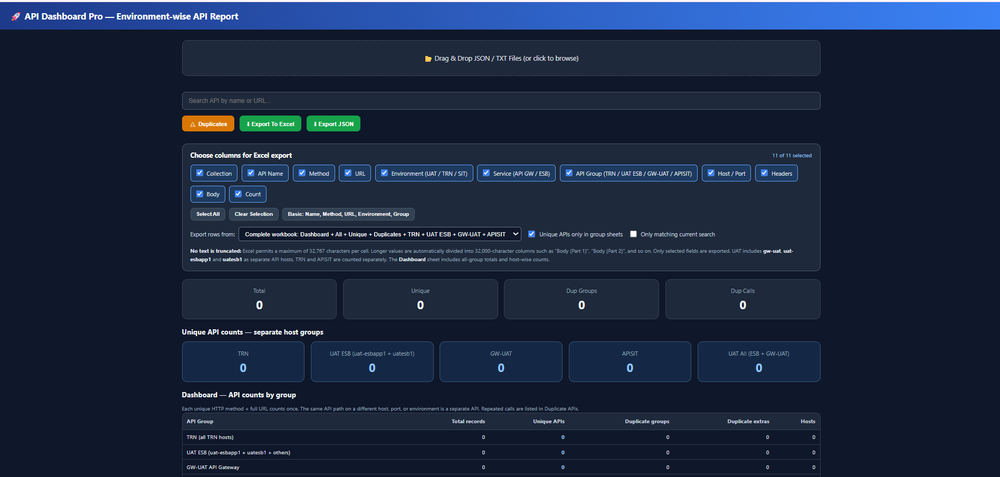

# 🚀 API Dashboard Pro – Environment-wise API Report

A standalone browser-based API inventory dashboard designed to import, analyze, classify, search, and report API collections across multiple environments.

The dashboard provides duplicate API detection, environment-wise statistics, host-wise breakdowns, configurable Excel exports, and JSON reporting.

## ✨ Key Features

### API Import
- Drag-and-drop JSON and TXT files.
- Import multiple files simultaneously.
- Analyze API collections and request details.
- Display API names, HTTP methods, URLs, headers, and request bodies.

### API Analysis
- Total API records.
- Unique API endpoint count.
- Duplicate API group identification.
- Duplicate call statistics.
- Host and port identification.
- Environment-wise API classification.

### Environment-wise Reporting

Supports the following API groups:

| Environment / Group | Description |
|---|---|
| TRN | Transaction environment |
| UAT ESB | UAT ESB hosts |
| GW-UAT | UAT API Gateway |
| APISIT | API SIT environment |
| UAT All | Combined UAT ESB and GW-UAT |

### Duplicate Detection
- Identify repeated API requests.
- Group APIs using HTTP method and full URL.
- Display duplicate groups and additional occurrences.
- Distinguish APIs hosted on different servers or ports.

### Search and Filtering
- Search by API name.
- Search by URL.
- View all APIs.
- View unique APIs.
- View duplicate APIs.
- Filter APIs by environment or group.

### Excel Export
Configurable Excel reporting with 11 selectable fields:

1. Collection
2. API Name
3. Method
4. URL
5. Environment
6. Service
7. API Group
8. Host / Port
9. Headers
10. Body
11. Count

Export options include:
- Complete workbook.
- Dashboard summary.
- All APIs.
- Unique APIs.
- Duplicate APIs.
- TRN APIs.
- UAT ESB APIs.
- GW-UAT APIs.
- APISIT APIs.
- Combined UAT APIs.
- Current filtered view.

Long text values are divided into multiple Excel columns to accommodate Excel's cell-length limit.

### JSON Export
Export structured JSON reports containing:
- Total imported API records.
- Unique API count.
- Duplicate groups.
- Duplicate call count.
- Dashboard summary.
- Host-wise summary.
- Unique API list.
- Duplicate API list.

## 🛠 Technology Stack

| Technology | Purpose |
|---|---|
| HTML5 | Application structure |
| CSS3 | Dashboard styling |
| JavaScript | Application logic |
| SheetJS 0.18.5 | Excel generation |
| Browser APIs | File import and downloads |

## 📋 Requirements

- Modern web browser.
- Windows, Linux or macOS.
- No Python installation required.
- No Node.js installation required.
- No database required.
- No backend server required for normal local use.

## 🚀 Installation and Usage

### Option 1: Download and Run

1. Download or clone this repository.
2. Open the project directory.
3. Open `index.html` in Chrome, Edge or Firefox.
4. Import your JSON or TXT API collection.
5. Review API statistics and environment-wise reports.
6. Export the results to Excel or JSON.

### Option 2: Clone Using Git

```bash
git clone https://github.com/YOUR-USERNAME/API-Dashboard-Pro.git
cd API-Dashboard-Pro
```

Open `index.html` in your browser.

## 📊 API Identification Rules

Unique API identification is based on:

**HTTP Method + Full URL**

The full URL includes the hostname, port, path and query string.

The same API path on a different hostname, port or environment is counted separately.

Repeated calls are grouped under duplicate APIs.

## 📁 Project Structure

```text
API-Dashboard-Pro/
│
├── index.html
├── README.md
├── LICENSE
├── .gitignore
│
├── docs/
│   └── usage.md
│
├── screenshots/
│   └── dashboard.png
│
└── examples/
    └── README.md
```

## 🔐 Security and Privacy

- API inventory files may contain confidential information.
- Review headers, authentication tokens and request bodies before sharing reports.
- Do not upload production credentials or confidential API collections to a public repository.
- Use sanitized sample data for demonstrations.
- Keep actual API inventory exports in approved secure storage.

## ⚠️ Limitations

- Intended for supported API collection JSON and TXT formats.
- Does not execute API requests.
- Does not perform API security testing.
- Does not connect to API gateways or backend services.
- API classification depends on the host-identification logic in the application.
- Export size is subject to Excel worksheet limits.

## 📸 Dashboard Preview




## 📄 License

This project is licensed under the MIT License.

You are free to use, copy, modify, distribute, and adapt this software in accordance with the MIT License terms.

See the [LICENSE](LICENSE) file for details.

## 👨‍💻 Author

**YOUR NAME**

GitHub: https://github.com/Swanoop10082001

## Disclaimer

This tool is intended for authorized API inventory management, documentation, analysis, and reporting.
